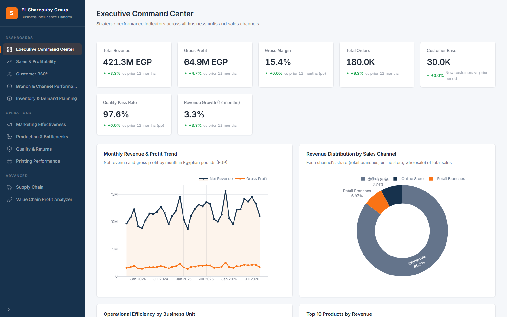
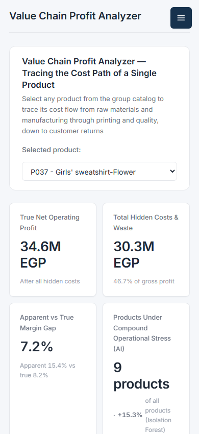

# El-Sharnouby Group — Business Intelligence Platform

A full-stack enterprise BI platform built with **FastAPI**, **Plotly**, and **pandas**, delivering 11 interactive dashboards covering sales, profitability, customers, operations, and the value chain — with a REST API for every dataset.



*Executive Command Center @1600×1000*



*Mobile view @390px*

## ✨ Features

- **11 interactive dashboards** — Executive Command Center, Sales & Profitability, Customer 360°, Branch & Channel Performance, Inventory & Demand Planning, Marketing Effectiveness, Production & Bottlenecks, Quality & Returns, Printing Performance, Supply Chain, and Value Chain Profit Analyzer
- **Server-rendered charts** — all figures computed with pandas and rendered as Plotly charts with a consistent navy/orange enterprise palette
- **REST API** — JSON endpoints for KPIs, charts, and product drill-downs under `/api/v1`
- **ML-powered forecasting** — inventory demand forecast and customer segmentation via scikit-learn
- **Centralized analytics core** — shared metrics, chart constants, models, and logging utilities
- **Responsive UI** — collapses to a mobile drawer layout below 768px

## 🚀 Getting Started

### Prerequisites

- Python 3.11+
- The dataset (see [Data](#-data))

### Installation

```bash
# 1. Clone the repository
git clone https://github.com/MohhamedIbrahem/El-Sharnouby-Group.git
cd El-Sharnouby-Group

# 2. Create a virtual environment
python -m venv venv
venv\Scripts\activate          # Windows
# source venv/bin/activate     # Linux / macOS

# 3. Install dependencies
pip install -r requirements.txt

# 4. Add the data (see Data section below)

# 5. Run the server
uvicorn app.main:app --reload --host 0.0.0.0 --port 8000
```

Open **http://localhost:8000** in your browser.

> On Windows, if the dev server crashes when a browser disconnects abruptly, use `python run_qa_server.py` — it forces a selector event loop that survives unclean disconnects.

## 📊 Data

The data folder **`Sharnouby_Enterprise/` is not included in this repository** (excluded via `.gitignore` — it is ~60 MB, with a single 52 MB transactions file).

To run the app, place the 21 CSV files in a `Sharnouby_Enterprise/` folder at the project root:

```
Sharnouby_Enterprise/
├── Business_Units.csv
├── Case_Briefs.csv
├── Customers.csv
├── Customer_Service.csv
├── Data_Dictionary.csv
├── Group_Operations.csv
├── Inventory_History.csv
├── Locations.csv
├── Machine_Downtime.csv
├── Marketing.csv
├── Materials.csv
├── Printing_Batches.csv
├── Product_BOM.csv
├── Product_Master.csv
├── Production_Orders.csv
├── Purchase_Orders.csv
├── Quality.csv
├── Sales_Transactions.csv
├── Suppliers.csv
└── Web_Traffic_Daily.csv
```

All CSVs are loaded automatically at startup into an in-memory store; no database is required.

## 🗂 Project Structure

```
├── app/
│   ├── main.py              # FastAPI app factory + lifespan data loading
│   ├── settings.py          # Pydantic settings (paths, palette, server)
│   ├── api/
│   │   ├── pages.py         # Dashboard page routes (Jinja2)
│   │   └── rest.py          # REST API under /api/v1
│   ├── core/
│   │   ├── charts.py        # Shared chart constants + base layout
│   │   ├── data_loader.py   # CSV loader (in-memory DATA store)
│   │   ├── logger.py        # Logging utilities
│   │   ├── metrics.py       # Shared metrics helpers
│   │   └── models.py        # Pydantic response models
│   ├── services/            # One analytics service per dashboard
│   │   ├── executive.py, sales.py, customers.py, channels.py
│   │   ├── inventory.py, marketing.py, production.py, quality.py
│   │   └── printing.py, supply_chain.py, value_chain.py
│   ├── ai/                  # ML layer: anomaly detection, clustering,
│   │                        # forecasting, RAG scaffold (`app/ai/rag/`)
│   ├── templates/           # Jinja2 pages, components, base layout
│   └── static/              # CSS, JS
├── Sharnouby_Enterprise/    # Dataset (not committed — add locally)
├── requirements.txt
├── run_qa_server.py         # Robust dev/QA launcher (selector loop)
└── validation_report.md     # Data findings validation (F1–F17 + P048)
```

## 🔌 REST API

Base URL: `/api/v1`

| Endpoint | Description |
|---|---|
| `GET /health` | Health check |
| `GET /executive/kpis` | Group-level KPIs |
| `GET /executive/charts/{chart_name}` | Executive charts |
| `GET /sales/kpis` | Sales KPIs |
| `GET /sales/charts/{chart_name}` | Sales charts |
| `GET /customers/kpis` · `/customers/segments` | Customer KPIs & ML segments |
| `GET /channels/kpis` | Branch & channel KPIs |
| `GET /inventory/kpis` · `/inventory/forecast` | Inventory KPIs & demand forecast |
| `GET /marketing/kpis` | Marketing KPIs |
| `GET /production/kpis` | Production KPIs |
| `GET /quality/kpis` | Quality KPIs |
| `GET /printing/kpis` | Printing KPIs |
| `GET /supply-chain/kpis` · `/supply-chain/charts/{chart_name}` | Supply chain |
| `GET /value-chain/kpis` · `/value-chain/product/{product_id}` · `/value-chain/charts/{chart_name}` | Value chain drill-down |

Interactive API docs: **http://localhost:8000/docs**

## 🛠 Tech Stack

| Layer | Technology |
|---|---|
| Backend | FastAPI, Uvicorn, Pydantic v2 |
| Data | pandas, NumPy |
| ML | scikit-learn (segmentation, demand forecast) |
| Visualization | Plotly (server-computed figures) |
| UI | Jinja2 templates, vanilla CSS/JS |
| Database | Optional — SQLAlchemy + aiosqlite (data loads from CSVs) |

## 📝 Notes

- `validation_report.md` documents 18 validated data findings (F1–F17 + P048) used to harden the analytics before release.
- The `.env` file is optional; all settings have sensible defaults (see `app/settings.py`).
