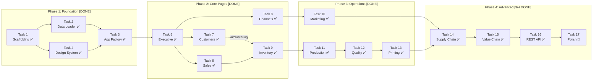

# 📋 El-Sharnouby Group — Execution Plan
## Phases & Tasks Breakdown

---

## 🚦 Project Progress Status

| Phase | Description | Status | Progress |
| :--- | :--- | :---: | :---: |
| **Phase 1: Foundation** | Scaffolding, Data Loader, App Factory, Design System | **Completed** | 100% (4/4 Tasks) ✅ |
| **Phase 2: Core Pages** | Executive, Sales, Customers, Channels, Inventory | **Completed** | 100% (5/5 Tasks) ✅ |
| **Phase 3: Operations** | Marketing, Production, Quality, Printing | **Completed** | 100% (4/4 Tasks) ✅ |
| **Phase 4: Advanced** | Supply Chain, Value Chain, REST API, Polish | **In Progress** | 75% (3/4 Tasks) 🚀 |

---

## Dependency Graph



> [!NOTE]
> Tasks within the same phase can often run in parallel (e.g., Tasks 6, 7, 8 after Task 5 is done). The dashed arrow shows an AI model dependency.

---

## Phase 1: 🏗️ Foundation ✅ [COMPLETED]
**Goal:** Get the project skeleton running with data loaded and a styled base layout.

> [!NOTE]
> **Status:** All tasks (1, 2, 3, 4) have been implemented and verified via automated testing across all 20 enterprise CSV datasets.

---

### Task 1: Project Scaffolding
**Files to create:**
| File | Purpose |
|------|---------|
| `app/__init__.py` | Package init |
| `app/settings.py` | Pydantic BaseSettings — data path, app title, future API keys |
| `app/core/__init__.py` | Core package init |
| `app/core/models.py` | Pydantic schemas: `KPICard`, `ChartData`, `PageContext` |
| `app/services/__init__.py` | Services package init |
| `app/ai/__init__.py` | AI package init |
| `app/ai/rag/__init__.py` | RAG package init (empty placeholder) |
| `app/api/__init__.py` | API package init |
| `requirements.txt` | All dependencies |

**Deliverables:**
- [x] Full folder structure created
- [x] `requirements.txt` with all Phase 1-4 deps
- [x] `settings.py` with `DATA_DIR`, `APP_TITLE`, `DEBUG` settings
- [x] `models.py` with base Pydantic schemas all services will return
- [x] All `__init__.py` files in place
- [x] `pip install -r requirements.txt` runs clean

**Dependencies:** None
**Complexity:** 🟢 Low

---

### Task 2: Core Data Loader
**Files to create:**
| File | Purpose |
|------|---------|
| `app/core/data_loader.py` | Load all 20 CSVs, clean, type-cast, store as global dict |

**Deliverables:**
- [x] Function `load_all_data(data_dir: Path) -> dict[str, pd.DataFrame]`
- [x] All 20 CSVs loaded with proper dtypes:
  - Date columns parsed as `datetime64`
  - Numeric columns cast (prices, quantities, percentages)
  - Categorical columns (Channel, Product_Family, etc.) as `category`
- [x] Data validation: log row counts, check for nulls in key columns
- [x] Global `DATA` dict accessible by all services
- [x] Pre-computed derived columns:
  - `Sales_Transactions`: `Year`, `Month`, `Quarter` from `Order_Date`
  - `Sales_Transactions`: `Is_Return` boolean from `Returned` column
  - `Production_Orders`: `Is_Delayed` boolean from `Delay_Days > 0`
  - `Purchase_Orders`: `Days_Late` = `Actual_Receipt_Date - Promised_Date`

**Dependencies:** Task 1 (needs settings.py for DATA_DIR)
**Complexity:** 🟡 Medium

---

### Task 3: App Factory & Router Setup
**Files to create:**
| File | Purpose |
|------|---------|
| `app/main.py` | FastAPI app with lifespan, middleware, router includes |
| `app/api/pages.py` | Page router — all 11 HTML page routes (stubs) |
| `app/api/rest.py` | REST router — `/api/v1/` JSON endpoint stubs |

**Deliverables:**
- [x] `main.py` with:
  - `lifespan` async context manager that calls `load_all_data()` on startup
  - Jinja2 template mounting
  - Static files mounting (`/static`)
  - Router includes: `pages.router`, `rest.router`
  - CORS middleware (for future chatbot)
- [x] `pages.py` with 11 route stubs (`@router.get("/")`, `@router.get("/sales")`, etc.) returning placeholder HTML
- [x] `rest.py` with `/api/v1/health` endpoint returning `{"status": "ok"}`
- [x] App starts with `uvicorn app.main:app --reload` without errors
- [x] Visiting `http://localhost:8000` shows the base template

**Dependencies:** Task 1, Task 2 (data loads on startup)
**Complexity:** 🟡 Medium

---

### Task 4: Design System & Base Layout
**Files to create:**
| File | Purpose |
|------|---------|
| `app/static/css/style.css` | Full RTL dark-mode design system |
| `app/templates/base.html` | Base layout: `<html lang="ar" dir="rtl">`, sidebar, content area |
| `app/templates/components/sidebar.html` | Navigation sidebar (right-side) |
| `app/templates/components/kpi_card.html` | Reusable KPI card macro |
| `app/templates/components/chart.html` | Reusable Plotly chart wrapper macro |
| `app/static/js/main.js` | Chart resizing, RTL helpers, sidebar toggle |

**Deliverables:**
- [x] `style.css` with:
  - CSS custom properties (all color tokens, spacing, typography)
  - Google Fonts: Cairo + Tajawal loaded
  - RTL layout: `direction: rtl`, CSS logical properties throughout
  - Glassmorphism card styles (`.card`, `.kpi-card`)
  - Sidebar styles (right-side, collapsible, glow active indicator)
  - Grid layouts for KPI cards (`.kpi-grid`) and charts (`.chart-grid`)
  - Responsive breakpoints (mobile, tablet, desktop)
  - Hover transitions, gradient borders
  - Plotly chart container styles
- [x] `base.html` with:
  - `<html lang="ar" dir="rtl">`
  - Cairo + Tajawal Google Fonts
  - Plotly.js CDN include
  - Sidebar include
  - Content block (``)
  - Page title block (``)
- [x] `sidebar.html` — 11 nav items with icons, Arabic labels, active state
- [x] `kpi_card.html` — Jinja2 macro: `kpi_card(title, value, delta, icon, color)`
- [x] `chart.html` — Jinja2 macro: `plotly_chart(chart_json, chart_id, height)`
- [x] `main.js` — Responsive chart resizing, sidebar collapse on mobile

**Dependencies:** Task 1 (folder structure)
**Complexity:** 🟡 Medium

---

## Phase 2: 📊 Core Pages ✅ [COMPLETED]
**Goal:** Build the 5 most important dashboard pages with real analytics and charts.

> [!NOTE]
> **Status:** All tasks (5, 6, 7, 8, 9) have been implemented and verified with live KPI metrics, interactive Plotly charts, and AI modules (K-Means & Forecasting).

---

### Task 5: لوحة القيادة التنفيذية (Executive Command Center)
**Files to create:**
| File | Purpose |
|------|---------|
| `app/services/executive.py` | Cross-dataset KPIs and chart data |
| `app/templates/pages/executive.html` | Executive dashboard page |

**Service functions:**
```python
get_executive_kpis(data) -> list[KPICard]
    # Total Revenue, Gross Profit, Net Margin, Total Orders, 
    # Total Customers, Avg Quality Pass Rate, YoY Growth %

get_revenue_profit_trend(data) -> ChartData
    # Monthly revenue & profit line chart

get_revenue_by_channel(data) -> ChartData
    # Donut: Retail vs Online vs Wholesale

get_business_unit_efficiency(data) -> ChartData
    # Grouped bar: each BU's operational efficiency over time

get_top_products(data, n=10) -> ChartData
    # Horizontal bar: top N products by revenue

get_seasonality_heatmap(data) -> ChartData
    # Heatmap: month × product family → revenue intensity
```

**Deliverables:**
- [x] 7 KPI cards across the top (Arabic labels)
- [x] 5 interactive Plotly charts
- [x] All charts have Arabic titles, axis labels, hover tooltips
- [x] Page loads in < 2 seconds
- [x] This is the home page (`/`)

**Dependencies:** Task 3, Task 4
**Complexity:** 🟡 Medium

---

### Task 6: المبيعات والربحية (Sales & Profitability)
**Files to create:**
| File | Purpose |
|------|---------|
| `app/services/sales.py` | Sales analytics |
| `app/templates/pages/sales.html` | Sales dashboard page |

**Service functions:**
```python
get_sales_kpis(data) -> list[KPICard]
get_revenue_vs_profit_trend(data) -> ChartData
get_revenue_by_product_family(data) -> ChartData      # Treemap
get_discount_impact_analysis(data) -> ChartData        # Scatter
get_growth_comparison(data) -> ChartData               # MoM/YoY bars
get_seasonality_by_family(data) -> ChartData           # Heatmap
get_top_bottom_margin_products(data, n=10) -> ChartData  # Diverging bar
```

**Deliverables:**
- [x] 5 KPI cards (الإيرادات, الوحدات, إجمالي الربح, متوسط الهامش, تأثير الخصومات)
- [x] 6 interactive charts with Arabic labels
- [x] Discount impact scatter shows clear margin erosion pattern
- [x] Route: `/sales`

**Dependencies:** Task 5 (establishes pattern for all pages)
**Complexity:** 🟡 Medium

---

### Task 7: ملف العميل ٣٦٠° (Customer 360 & Retention)
**Files to create:**
| File | Purpose |
|------|---------|
| `app/services/customers.py` | RFM analysis, cohorts, segmentation |
| `app/ai/clustering.py` | K-Means customer clustering |
| `app/templates/pages/customers.html` | Customer 360 page |

**Service functions:**
```python
get_customer_kpis(data) -> list[KPICard]
compute_rfm_scores(data) -> pd.DataFrame
get_rfm_scatter(data) -> ChartData
get_customer_segments(data) -> ChartData              # Pie
get_cohort_retention_heatmap(data) -> ChartData
get_aov_distribution(data) -> ChartData               # Histogram
get_new_vs_returning_trend(data) -> ChartData          # Stacked area
get_customer_geography(data) -> ChartData              # Bar by governorate
```

**AI module (`ai/clustering.py`):**
```python
segment_customers_kmeans(rfm_df, n_clusters=4) -> pd.DataFrame
    # Returns RFM df with 'Segment' column: أبطال, أوفياء, معرضون للخطر, مفقودون
```

**Deliverables:**
- [x] 5 KPI cards
- [x] 6 interactive charts
- [x] AI-powered customer segmentation via K-Means
- [x] Cohort retention heatmap (month of first purchase × months since)
- [x] Arabic segment names
- [x] Route: `/customers`

**Dependencies:** Task 5
**Complexity:** 🔴 High (RFM + AI clustering)

---

### Task 8: أداء الفروع والقنوات (Branch & Channel Performance)
**Files to create:**
| File | Purpose |
|------|---------|
| `app/services/channels.py` | Channel comparison analytics |
| `app/templates/pages/channels.html` | Channels page |

**Service functions:**
```python
get_channel_kpis(data) -> list[KPICard]
get_channel_comparison(data) -> ChartData          # Grouped bar
get_channel_growth_trend(data) -> ChartData        # Multi-line
get_returns_by_channel(data) -> ChartData           # Stacked bar
get_geographic_demand(data) -> ChartData            # Bar by governorate
get_channel_mix_evolution(data) -> ChartData        # Stacked area %
```

**Deliverables:**
- [x] 4 KPI cards (per-channel revenue, margin, returns, basket size)
- [x] 5 interactive charts
- [x] Route: `/channels`

**Dependencies:** Task 5
**Complexity:** 🟢 Low

---

### Task 9: المخزون وتخطيط الطلب (Inventory & Demand Planning)
**Files to create:**
| File | Purpose |
|------|---------|
| `app/services/inventory.py` | Inventory analytics, ABC/XYZ |
| `app/ai/forecasting.py` | Time-series demand forecasting |
| `app/templates/pages/inventory.html` | Inventory page |

**Service functions:**
```python
get_inventory_kpis(data) -> list[KPICard]
classify_abc_xyz(data) -> pd.DataFrame
get_abc_xyz_matrix(data) -> ChartData               # Scatter matrix
get_stock_turns(data) -> ChartData                  # Bar
get_days_of_cover(data) -> ChartData                # Box plot
get_stockout_overstock(data) -> ChartData            # Scatter
get_demand_forecast(data, horizons=[30,60,90]) -> ChartData  # Line + bands
```

**AI module (`ai/forecasting.py`):**
```python
forecast_demand(sales_history, horizon_days=90) -> pd.DataFrame
    # Exponential smoothing or linear trend forecast
    # Returns date, forecast, lower_bound, upper_bound
```

**Deliverables:**
- [x] 5 KPI cards
- [x] 5 interactive charts
- [x] ABC/XYZ automated classification
- [x] 30/60/90-day demand forecast with confidence bands
- [x] Route: `/inventory`

**Dependencies:** Task 6 (sales data patterns), Task 7 (clustering pattern reuse)
**Complexity:** 🔴 High (ABC/XYZ + forecasting)

---

## Phase 3: ⚙️ Operations Pages ✅ [COMPLETED]
**Goal:** Build the 4 operations-focused dashboard pages.

> [!NOTE]
> **Status:** All tasks (10, 11, 12, 13) have been implemented and verified with live KPI metrics, interactive Plotly charts, and sortable campaign data.

---

### Task 10: فعالية التسويق (Marketing Effectiveness)
**Files to create:**
| File | Purpose |
|------|---------|
| `app/services/marketing.py` | Campaign analytics, ROAS, web funnel |
| `app/templates/pages/marketing.html` | Marketing page |

**Service functions:**
```python
get_marketing_kpis(data) -> list[KPICard]
get_roas_by_platform(data) -> ChartData             # Bar
get_spend_vs_revenue(data) -> ChartData             # Bubble scatter
get_campaign_table(data) -> list[dict]              # Sortable table data
get_ctr_trend(data) -> ChartData                    # Multi-line
get_budget_allocation(data) -> ChartData            # Donut recommendation
get_web_funnel(data) -> ChartData                   # Funnel chart
```

**Deliverables:**
- [x] 5 KPI cards (إجمالي الإنفاق, الإيرادات المنسوبة, ROAS, CAC, معدل التحويل)
- [x] 5 charts + 1 sortable campaign table
- [x] Web traffic funnel from Sessions → Orders
- [x] Route: `/marketing`

**Dependencies:** Task 5 (page pattern established)
**Complexity:** 🟡 Medium

---

### Task 11: الإنتاج والاختناقات (Factory Production & Bottlenecks)
**Files to create:**
| File | Purpose |
|------|---------|
| `app/services/production.py` | Production analytics |
| `app/templates/pages/production.html` | Production page |

**Service functions:**
```python
get_production_kpis(data) -> list[KPICard]
get_efficiency_by_line(data) -> ChartData            # Bar
get_plan_vs_actual(data) -> ChartData                # Grouped bar
get_bottleneck_pareto(data) -> ChartData             # Pareto bar
get_delay_distribution(data) -> ChartData            # Histogram
get_overtime_trend(data) -> ChartData                # Line
get_efficiency_trend(data) -> ChartData              # Multi-line by line
```

**Deliverables:**
- [x] 5 KPI cards (الإنتاج, الكفاءة, التأخيرات, نسبة الرفض, ساعات إضافية)
- [x] 6 interactive charts
- [x] Bottleneck Pareto clearly shows top causes
- [x] Route: `/production`

**Dependencies:** Task 5
**Complexity:** 🟡 Medium

---

### Task 12: الجودة والمرتجعات (Quality, Returns & COPQ)
**Files to create:**
| File | Purpose |
|------|---------|
| `app/services/quality.py` | Quality + returns correlation analytics |
| `app/templates/pages/quality.html` | Quality page |

**Service functions:**
```python
get_quality_kpis(data) -> list[KPICard]
get_defect_pareto(data) -> ChartData                # Pareto bar
get_root_cause_analysis(data) -> ChartData          # Bar
get_quality_by_stage(data) -> ChartData             # Stacked bar
get_quality_loss_trend(data) -> ChartData           # Line
get_return_reasons(data) -> ChartData               # Pie
get_quality_return_correlation(data) -> ChartData   # Connected scatter
```

**Deliverables:**
- [x] 5 KPI cards (الفحص, نسبة النجاح, نسبة الرفض, خسائر الجودة, نسبة المرتجعات)
- [x] 6 interactive charts
- [x] Quality ↔ Return correlation connecting QC defects to customer returns
- [x] Route: `/quality`

**Dependencies:** Task 5
**Complexity:** 🟡 Medium

---

### Task 13: أداء الطباعة (Printing Performance & Downtime)
**Files to create:**
| File | Purpose |
|------|---------|
| `app/services/printing.py` | Printing + downtime analytics |
| `app/templates/pages/printing.html` | Printing page |

**Service functions:**
```python
get_printing_kpis(data) -> list[KPICard]
get_machine_yield(data) -> ChartData                # Bar by machine
get_defect_types(data) -> ChartData                 # Pie
get_reprint_cost_trend(data) -> ChartData           # Line
get_downtime_by_reason(data) -> ChartData           # Horizontal bar
get_planned_vs_unplanned(data) -> ChartData         # Stacked bar
get_machine_utilization_heatmap(data) -> ChartData  # Machine × month
```

**Deliverables:**
- [x] 5 KPI cards (إجمالي المطبوع, العائد, إعادة الطباعة, ساعات التوقف, تكلفة المواد)
- [x] 6 interactive charts
- [x] Machine utilization heatmap identifies worst-performing machines
- [x] Route: `/printing`

**Dependencies:** Task 5
**Complexity:** 🟡 Medium

---

## Phase 4: 🚀 Advanced + API [3/4 DONE — Task 17 in progress]
**Goal:** Complete remaining pages, build REST API, and polish the entire application.

---

### Task 14: سلسلة التوريد (Supply Chain & Materials)
**Files to create:**
| File | Purpose |
|------|---------|
| `app/services/supply_chain.py` | Supplier scoring, material risk |
| `app/templates/pages/supply_chain.html` | Supply chain page |

**Service functions:**
```python
get_supply_chain_kpis(data) -> list[KPICard]
get_supplier_scorecard(data) -> ChartData           # Radar
get_lead_time_distribution(data) -> ChartData       # Box plot by supplier
get_acceptance_rate(data) -> ChartData              # Bar by supplier
get_cost_trend(data) -> ChartData                   # Line by category
get_supplier_risk_matrix(data) -> ChartData         # Scatter
get_material_criticality(data) -> ChartData         # Bubble
```

**Deliverables:**
- [x] 5 KPI cards
- [x] 6 interactive charts
- [x] Supplier risk matrix (delivery risk vs quality risk)
- [x] Route: `/supply-chain`

**Dependencies:** Task 5
**Complexity:** 🟡 Medium

---

### Task 15: محلل ربحية سلسلة القيمة (Value Chain Profitability — App 11 ⭐)
**Files to create:**
| File | Purpose |
|------|---------|
| `app/services/value_chain.py` | Cross-department cost tracing |
| `app/ai/anomaly.py` | Isolation Forest anomaly detection |
| `app/templates/pages/value_chain.html` | Value chain page |

**Service functions:**
```python
get_value_chain_kpis(data) -> list[KPICard]
get_product_journey_waterfall(data, product_id) -> ChartData
    # Waterfall: material cost → production → print → quality loss → 
    #            inventory holding → return cost → TRUE net profit

get_true_profitability_leaderboard(data) -> ChartData
    # All products ranked by real margin (after ALL costs)

get_hidden_cost_breakdown(data) -> ChartData        # Treemap
get_cross_dept_anomalies(data) -> ChartData         # Flagged products
get_profitability_gap(data) -> ChartData            # Scatter: apparent vs real
```

**AI module (`ai/anomaly.py`):**
```python
detect_cross_department_anomalies(data) -> pd.DataFrame
    # Isolation Forest on multi-department features per product
    # Returns products with anomaly_score and flag
```

**Deliverables:**
- [x] 4 KPI cards (الربحية الحقيقية, التكاليف الخفية, المنتجات تحت الحد, إجمالي التكاليف الخفية)
- [x] 5 interactive charts including product journey waterfall
- [x] Product selector dropdown to trace any product's full cost journey
- [x] AI anomaly flags for products with converging stress signals
- [x] Route: `/value-chain`

**Dependencies:** Task 14 (needs supply chain data patterns), all prior services
**Complexity:** 🔴 High (cross-dataset joins + AI)

---

### Task 16: REST API Endpoints
**Files to modify:**
| File | Purpose |
|------|---------|
| `app/api/rest.py` | JSON versions of all service outputs |

**Endpoints to implement:**
```
GET /api/v1/health
GET /api/v1/executive/kpis
GET /api/v1/executive/charts/{chart_name}
GET /api/v1/sales/kpis
GET /api/v1/sales/charts/{chart_name}
GET /api/v1/customers/kpis
GET /api/v1/customers/segments
GET /api/v1/channels/kpis
GET /api/v1/inventory/kpis
GET /api/v1/inventory/forecast
GET /api/v1/marketing/kpis
GET /api/v1/production/kpis
GET /api/v1/quality/kpis
GET /api/v1/printing/kpis
GET /api/v1/supply-chain/kpis
GET /api/v1/value-chain/kpis
GET /api/v1/value-chain/product/{product_id}
```

**Deliverables:**
- [x] All service outputs available as JSON
- [x] Swagger docs at `/docs` (automatic from FastAPI)
- [x] Response schemas use Pydantic models
- [x] These endpoints are ready for future chatbot/RAG to call

**Dependencies:** All service modules (Tasks 5-15)
**Complexity:** 🟢 Low (services already built, just wire them)

---

### Task 17: Polish & Final QA
**Files to modify:**
| File | Purpose |
|------|---------|
| All templates | Final UI polish |
| `style.css` | Animation refinements |
| `main.js` | Performance optimizations |

**Deliverables:**
- [ ] All 11 pages load without errors
- [ ] Charts resize properly on window resize
- [ ] Sidebar collapse works on mobile
- [ ] Hover animations smooth on all cards and charts
- [ ] Arabic text renders properly everywhere (no encoding issues)
- [ ] RTL layout correct — no left-aligned elements
- [ ] Page load time < 3 seconds for each page
- [ ] All Plotly charts have Arabic tooltips
- [ ] Console has zero JavaScript errors
- [ ] Favicon and page titles set

**Dependencies:** All tasks complete
**Complexity:** 🟡 Medium

---

## Summary Table

| Phase | Tasks | Files | Charts | AI Features | Status |
|-------|-------|-------|--------|-------------|:------:|
| **1. Foundation** | 4 tasks (T1-T4) | ~15 files | 0 | None | **Completed ✅** |
| **2. Core Pages** | 5 tasks (T5-T9) | ~13 files | ~27 charts | K-Means, Forecasting | **Completed ✅** |
| **3. Operations** | 4 tasks (T10-T13) | ~8 files | ~23 charts | None | **Completed ✅** |
| **4. Advanced** | 4 tasks (T14-T17) | ~6 files | ~17 charts | Isolation Forest | **3/4 Done 🚀 (Polish remaining)** |
| **Total** | **17 tasks** | **~42 files** | **~67 charts** | **3 AI models** | **16/17 Tasks Done** |

---

## Execution Order (Recommended)

```
[DONE] T1 → T2 ──→ T3 ──→ [DONE] T5 ──→ T6 ──→ T9
               ↘         ↗             ↗      ↗
                T4 ─────              T7     [DONE] T10 → [DONE] T14 → [DONE] T15 → [DONE] T16 → [CURRENT] T17
                                       T8            T11
                                                     T12
                                                     T13
```

> [!TIP]
> **Parallel tracks after Task 5:** Once the Executive page establishes the pattern, Tasks 6/7/8 and Tasks 10/11/12/13 can be built in any order. Task 15 (Value Chain) must be last because it joins data from all other services.
