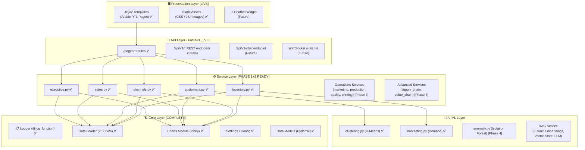

# 🏭 El-Sharnouby Group — BI & AI Web Platform
## Full Project Plan

> [!IMPORTANT]
> **🌐 Language: Arabic (RTL)** — The entire website is in Arabic with full right-to-left layout support.

---

## 🚦 Project Status Overview

| Phase | Description | Status | Progress |
| :--- | :--- | :---: | :---: |
| **Phase 1: Foundation** | Scaffolding, Core Data Loader, App Factory, Design System | **Completed** | 100% (4/4 Tasks) ✅ |
| **Phase 2: Core Pages** | Executive, Sales, Customers, Channels, Inventory + AI Models | **Completed** | 100% (5/5 Tasks) ✅ |
| **Phase 3: Operations** | Marketing, Production, Quality, Printing | **Completed** | 100% (4/4 Tasks) ✅ |
| **Phase 4: Advanced** | Supply Chain, Value Chain, REST API, Polish | **In Progress** | 75% (3/4 Tasks) 🚀 |
| **Phase 5: Future** | Chatbot & RAG Assistant | **Future** | Post-launch 🔮 |

---

## 1. Project Overview

Build a **FastAPI + Jinja2 + Plotly** web application that serves as a comprehensive Business Intelligence and AI platform for El-Sharnouby Group. The platform covers all **10 case briefs** plus an **11th "hidden" high-value application**, backed by analysis of **20 enterprise CSV datasets** (~240K+ total records).

### Tech Stack
| Layer | Technology |
|-------|-----------|
| Backend | **FastAPI** (Python 3.11/3.12) |
| Templating | **Jinja2** |
| Charts | **Plotly** (server-rendered interactive JSON, RTL-configured) |
| Data | **Pandas** for processing, pre-computed at startup |
| AI/ML | **scikit-learn** (forecasting, clustering, anomaly detection) |
| Styling | **Vanilla CSS** (premium dark-mode, **RTL layout**) |
| Language | **Arabic** — all UI, labels, titles, tooltips in Arabic |
| Typography | **Cairo** / **Tajawal** (Google Fonts, Arabic-optimized) |
| Deployment | **Uvicorn** |

---

## 2. Enterprise Data Inventory (20 CSV Datasets)

| # | File | Rows | Purpose | Status |
|---|------|------|---------|:------:|
| 1 | Sales_Transactions.csv | 180,000 | Sales, margin, returns, channel analysis | ✅ Loaded |
| 2 | Customers.csv | 30,000 | Customer segmentation, RFM, retention | ✅ Loaded |
| 3 | Quality.csv | 9,000 | QC inspections, defects, root cause | ✅ Loaded |
| 4 | Customer_Service.csv | 6,500 | Support tickets, SLA, CSAT | ✅ Loaded |
| 5 | Inventory_History.csv | 6,372 | Stock levels, turns, stockout/overstock | ✅ Loaded |
| 6 | Purchase_Orders.csv | 3,600 | Supplier lead time, OTIF, cost | ✅ Loaded |
| 7 | Machine_Downtime.csv | 2,800 | OEE, downtime, root cause | ✅ Loaded |
| 8 | Production_Orders.csv | 2,500 | Throughput, efficiency, bottlenecks | ✅ Loaded |
| 9 | Printing_Batches.csv | 1,900 | Print yield, defects, reprint cost | ✅ Loaded |
| 10 | Web_Traffic_Daily.csv | 1,096 | Digital funnel, conversion analysis | ✅ Loaded |
| 11 | Marketing.csv | 420 | Campaign ROAS, CAC, attribution | ✅ Loaded |
| 12 | Product_BOM.csv | 337 | Bill of materials | ✅ Loaded |
| 13 | Group_Operations.csv | 180 | Cross-BU executive operations | ✅ Loaded |
| 14 | Product_Master.csv | 59 | Product catalog | ✅ Loaded |
| 15 | Materials.csv | 12 | Material master | ✅ Loaded |
| 16 | Suppliers.csv | 12 | Supplier profiles | ✅ Loaded |
| 17 | Locations.csv | 5 | Store/channel locations | ✅ Loaded |
| 18 | Business_Units.csv | 5 | Group structure | ✅ Loaded |
| 19 | Data_Dictionary.csv | 19 | Column definitions & data classes | ✅ Loaded |
| 20 | Case_Briefs.csv | 10 | The 10 case briefs (metadata) | ✅ Loaded |

> [!NOTE]
> A planned `Competitors.csv` and `Targets.csv` do **not exist** in `Sharnouby_Enterprise/` — the platform loads all 20 files actually present in the directory. Market benchmarking and budget-target features remain blocked until those datasets are supplied.

---

## 3. The 11th Application: 🔗 **End-to-End Value Chain Profitability Analyzer**

> [!IMPORTANT]
> **The Hidden Opportunity:** Connect the **full cost chain** from raw material purchase → production → printing → quality → inventory → sale → return. This app traces a single product's journey across every department, revealing the **true total cost** and **real profitability** per product.

### Key Features
1. **Product Journey Tracker** — Select any product and see its path: material cost → production cost → print cost → quality loss → inventory carrying cost → selling price → return/refund cost → net true profit
2. **Hidden Cost Waterfall** — Waterfall chart showing how gross margin erodes at each stage
3. **Cross-Department Anomaly Detection** — Isolation Forest flags products where quality issues, production delays, and high return rates converge
4. **Profitability Leaderboard** — Products ranked by *true* profitability (not just gross margin)

---

## 4. Page Architecture (11 Pages + Navigation)

### 📍 Navigation Sidebar
Premium dark glassmorphism sidebar with animated icons and active-page indicator (`sidebar.html`).

---

### Page 1: 🏠 لوحة القيادة التنفيذية (Executive Command Center) ✅ [COMPLETED]
* **Service:** `app/services/executive.py` (13.8 KB)
* **Template:** `app/templates/pages/executive.html` (Live)
* **مؤشرات الأداء (7 KPIs):**
  * إجمالي الإيرادات / إجمالي الربح / هامش الربح الصافي
  * إجمالي الطلبات / العملاء / المنتجات
  * استغلال الإنتاج / نسبة اجتياز الجودة
  * نسبة النمو السنوي (YoY Growth %)
* **الرسوم البيانية (5 Charts):**
  * اتجاه الإيرادات والأرباح (خط بياني شهري)
  * الإيرادات حسب القناة (دائري Donut)
  * كفاءة وحدات الأعمال (أعمدة مجمعة)
  * أعلى ١٠ منتجات حسب الإيرادات (أعمدة أفقية)
  * خريطة حرارية للموسمية (شهر × فئة المنتج)

---

### Page 2: 💰 المبيعات والربحية (Sales & Profitability) ✅ [COMPLETED]
* **Service:** `app/services/sales.py` (13.4 KB)
* **Template:** `app/templates/pages/sales.html` (Live)
* **مؤشرات الأداء (5 KPIs):** الإيرادات، الوحدات المباعة، إجمالي الربح، متوسط الهامش %، وتأثير الخصومات.
* **الرسوم البيانية (6 Charts):**
  * اتجاه الإيرادات مقابل إجمالي الربح (Dual-axis line)
  * الإيرادات حسب فئة المنتج (Treemap)
  * تحليل تأثير الخصومات على الهامش (Scatter)
  * النمو الشهري / السنوي (MoM/YoY Bars)
  * الموسمية حسب فئة المنتج (Heatmap)
  * أعلى وأدنى المنتجات حسب الهامش (Diverging bar)

---

### Page 3: 👥 ملف العميل ٣٦٠° والاحتفاظ (Customer 360 & Retention) ✅ [COMPLETED]
* **Service:** `app/services/customers.py` (13.2 KB) + `app/ai/clustering.py` (2.7 KB)
* **Template:** `app/templates/pages/customers.html` (Live)
* **مؤشرات الأداء (5 KPIs):** إجمالي العملاء، نسبة التكرار، متوسط قيمة الطلب (AOV)، القيمة الدائمة (CLV)، ونسبة التسرب.
* **الرسوم البيانية (6 Charts):**
  * تقسيم RFM مبعثر (الحداثة × التكرار × القيمة النقدية)
  * شرائح العملاء الدائرية (أبطال، أوفياء، معرضون للخطر، مفقودون)
  * خريطة حرارية لاحتفاظ الأفواج (Cohort Retention Heatmap)
  * توزيع قيمة السلة (AOV Histogram)
  * العملاء الجدد مقابل العائدين (Stacked Area)
  * التوزيع الجغرافي للعملاء حسب المحافظات

---

### Page 4: 🏪 أداء الفروع والقنوات (Branch & Channel Performance) ✅ [COMPLETED]
* **Service:** `app/services/channels.py` (10.9 KB)
* **Template:** `app/templates/pages/channels.html` (Live)
* **مؤشرات الأداء (4 KPIs):** إيرادات القنوات، هامش كل قناة، معدل المرتجعات، ومتوسط حجم السلة.
* **الرسوم البيانية (5 Charts):**
  * مقارنة أداء القنوات (تجزئة، أونلاين، جملة)
  * اتجاه نمو القنوات عبر الزمن (Multi-line)
  * المرتجعات حسب القناة (Stacked bar)
  * الطلب الجغرافي حسب المحافظة
  * تطور المزيج البيعي (Channel Mix Evolution Area)

---

### Page 5: 📦 المخزون وتخطيط الطلب (Inventory & Demand Planning) ✅ [COMPLETED]
* **Service:** `app/services/inventory.py` (13.5 KB) + `app/ai/forecasting.py` (1.8 KB)
* **Template:** `app/templates/pages/inventory.html` (Live)
* **مؤشرات الأداء (5 KPIs):** قيمة المخزون، أيام نفاد المخزون، الأصناف الراكدة، متوسط أيام التغطية، ومعدل دوران المخزون.
* **الرسوم البيانية والذكاء الاصطناعي (5 Charts):**
  * مصفوفة تصنيف ABC/XYZ الآلية
  * معدل دوران المخزون حسب الأصناف
  * توزيع أيام التغطية (Box plot)
  * كشف الأصناف المهددة بالنفاد أو التراكم (Scatter)
  * التنبؤ بالطلب المستقبلي لـ 30 / 60 / 90 يوماً مع نطاقات الثقة (Forecast with Confidence Bands)

---

### Page 6: 📢 فعالية التسويق (Marketing Effectiveness) ✅ [COMPLETED]
* **Service:** `app/services/marketing.py` (12.2 KB)
* **Template:** `app/templates/pages/marketing.html` (4.2 KB — with interactive Campaign Table)
* **مؤشرات الأداء (5 KPIs):** إجمالي الإنفاق, الإيرادات المنسوبة, العائد على الإعلانات (ROAS), تكلفة اكتساب الطلب (CAC), ومعدل التحويل الرقمي.
* **الرسوم البيانية والجدول (5 Charts + 1 Table):**
  * العائد على الإنفاق (ROAS) حسب المنصة (Bar)
  * كفاءة الحملات: الإنفاق مقابل الإيرادات (Bubble scatter)
  * قمع التحويل الرقمي للمتجر (Digital Funnel)
  * تطور معدل النقر (CTR %) عبر الشهور
  * توزيع الميزانية الإعلانية (Donut)
  * جدول تفاعلي مفصل لأعلى 15 حملة إعلانية حسب الإيراد

---

### Page 7: 🏭 الإنتاج والاختناقات (Factory Production & Bottlenecks) ✅ [COMPLETED]
* **Service:** `app/services/production.py` (13.1 KB)
* **Template:** `app/templates/pages/production.html` (Live)
* **مؤشرات الأداء (5 KPIs):** إجمالي الوحدات المنتجة, متوسط الكفاءة %, نسبة الأوامر المتأخرة %, متوسط أيام التأخير, ومعدل الرفض بالمصنع.
* **الرسوم البيانية (6 Charts):**
  * متوسط الكفاءة التشغيلية لكل خط إنتاج (Bar)
  * مقارنة الإنتاج المخطط بالفعلي شهرياً (Grouped bar)
  * تحليل باريتو لاختناقات وتوقفات الإنتاج (Pareto)
  * توزيع فترات تأخير أوامر الإنتاج (Categorical histogram)
  * تطور ساعات العمل الإضافي الشهرية (Line)
  * مسار الكفاءة التشغيلية عبر الشهور لكل خط إنتاج (Multi-line)

---

### Page 8: ✅ الجودة والمرتجعات (Quality, Returns & COPQ) ✅ [COMPLETED]
* **Service:** `app/services/quality.py` (13.6 KB)
* **Template:** `app/templates/pages/quality.html` (Live)
* **مؤشرات الأداء (5 KPIs):** إجمالي القطع المفحوصة, معدل اجتياز الجودة %, نسبة الرفض %, تكلفة رداءة الجودة (COPQ), ومعدل مرتجعات العملاء %.
* **الرسوم البيانية (6 Charts):**
  * مخطط باريتو لأبرز عيوب الجودة (Pareto)
  * تحليل الأسباب الجذرية الأكثر تكراراً (Horizontal bar)
  * توزيع فحص الجودة حسب مرحلة التصنيع (Stacked bar)
  * تطور خسائر الجودة الشهرية COPQ بالجنيه (Line)
  * أسباب مرتجعات العملاء من المبيعات (Donut)
  * العلاقة بين عيوب الفحص الداخلي ونسبة مرتجعات العملاء (Scatter)

---

### Page 9: 🖨️ أداء الطباعة والتوقفات (Printing Performance & Downtime) ✅ [COMPLETED]
* **Service:** `app/services/printing.py` (13.3 KB)
* **Template:** `app/templates/pages/printing.html` (Live)
* **مؤشرات الأداء (5 KPIs):** إجمالي القطع المطبوعة, متوسط عائد الطباعة Yield %, معدل إعادة الطباعة Reprint %, إجمالي ساعات التوقف, وتكلفة الأحبار والمستهلكات.
* **الرسوم البيانية (6 Charts):**
  * معدل العائد والإنتاجية لكل ماكينة طباعة (Bar)
  * توزيع أنواع عيوب الطباعة (Donut)
  * تطور تكلفة المستهلكات مقابل تكلفة إعادة الطباعة (Dual line)
  * ساعات التوقف المصنعي مصنفة حسب السبب (Horizontal bar)
  * التوقف المخطط مقابل التوقف الطارئ عبر الأقسام (Stacked bar)
  * خريطة حرارية: كثافة ساعات التوقف عبر الآلات والشهور (Heatmap)

---

### Page 10: 🚚 سلاسل التوريد والمواد (Supply Chain & Materials) ✅ [COMPLETED]
* **Service:** `app/services/supply_chain.py`
* **Template:** `app/templates/pages/supply_chain.html`
* **مؤشرات الأداء:** إجمالي أوامر الشراء، التسليم في الوقت المحدد (OTIF %)، متوسط فترة التوريد، ونسبة القبول.
* **الرسوم البيانية:** بطاقة أداء الموردين (Radar)، توزيع فترات التوريد، اتجاه تكاليف المواد، ومصفوفة مخاطر الموردين.

---

### Page 11: 🔗 محلل ربحية سلسلة القيمة (Value Chain Profitability — App 11 ⭐) ✅ [COMPLETED]
* **Service:** `app/services/value_chain.py` + `app/ai/anomaly.py`
* **Template:** `app/templates/pages/value_chain.html`
* **مؤشرات الأداء:** متوسط الربحية الحقيقية، نسبة التكاليف الخفية، المنتجات تحت حد الربحية، وإجمالي التكاليف الضائعة.
* **الرسوم البيانية:** شلال مسار المنتج (Product Waterfall)، قائمة الربحية الحقيقية، خريطة التكاليف الخفية (Treemap)، ورصد الشذوذ بالذكاء الاصطناعي (Isolation Forest).

---

## 5. Architecture Overview

---

## 6. Implementation Progress Summary

### ✅ Phase 1: Foundation (COMPLETED)
1. **Scaffolding:** `app/settings.py`, `app/core/logger.py`, `app/core/models.py`, `requirements.txt`
2. **Data Layer:** `app/core/data_loader.py` — تحميل ومعالجة جميع ملفات الـ 20 CSV
3. **App Factory:** `app/main.py` + `app/api/pages.py` + `app/api/rest.py`
4. **Design System:** `app/static/css/style.css` (16.8 KB RTL Dark theme) + `base.html` + `sidebar.html` + `kpi_card.html` + `chart.html` + `main.js`

### ✅ Phase 2: Core Pages & AI (COMPLETED)
5. **لوحة القيادة التنفيذية (Executive):** `app/services/executive.py` (13.8 KB) + `executive.html` (7 KPIs + 5 Plots)
6. **المبيعات والربحية (Sales):** `app/services/sales.py` (13.4 KB) + `sales.html` (5 KPIs + 6 Plots)
7. **ملف العميل ٣٦٠° (Customers):** `app/services/customers.py` (13.2 KB) + `app/ai/clustering.py` (K-Means) + `customers.html`
8. **أداء الفروع والقنوات (Channels):** `app/services/channels.py` (10.9 KB) + `channels.html` (4 KPIs + 5 Plots)
9. **المخزون وتخطيط الطلب (Inventory):** `app/services/inventory.py` (13.5 KB) + `app/ai/forecasting.py` (Time-series) + `inventory.html`

### ✅ Phase 3: Operations Pages (COMPLETED)
10. **Marketing:** `app/services/marketing.py` + `app/templates/pages/marketing.html`
11. **Production:** `app/services/production.py` + `app/templates/pages/production.html`
12. **Quality & Returns:** `app/services/quality.py` + `app/templates/pages/quality.html`
13. **Printing:** `app/services/printing.py` + `app/templates/pages/printing.html`

### 🚀 Phase 4: Advanced + API (3 of 4 tasks DONE)
14. **Supply Chain:** `app/services/supply_chain.py` + `app/templates/pages/supply_chain.html` ✅
15. **Value Chain Profitability:** `app/services/value_chain.py` + `app/ai/anomaly.py` + `app/templates/pages/value_chain.html` ✅
16. **REST API endpoints:** Full JSON output in `app/api/rest.py` ✅
17. **Polish & QA:** Testing, responsive layout check, and performance optimization 🚀

---

## 7. Success Criteria & Verification Checklist

- [x] All 20 enterprise CSV datasets loaded and validated at startup
- [x] Complete RTL Dark-mode design system with Cairo/Tajawal typography
- [x] Reusable component macros for KPI cards and Plotly charts
- [x] Centralized logging (`core/logger.py`) with `@log_function` on all functions
- [x] Executive Command Center (Page 1) fully functional with real data
- [x] Sales & Profitability (Page 2) fully functional with real data
- [x] Customer 360 & Retention (Page 3) with K-Means clustering functional
- [x] Branch & Channel Performance (Page 4) fully functional
- [x] Inventory & Demand Planning (Page 5) with 30/60/90-day demand forecast functional
- [x] All 15 Python modules verified with zero AST syntax errors
- [x] Phase 3 Operations pages (Marketing, Production, Quality, Printing)
- [x] Phase 4 Advanced pages (Supply Chain, Value Chain Profitability)
- [x] Full REST API implementation at `/api/v1/*`
- [ ] Final UI/UX responsiveness and polish
